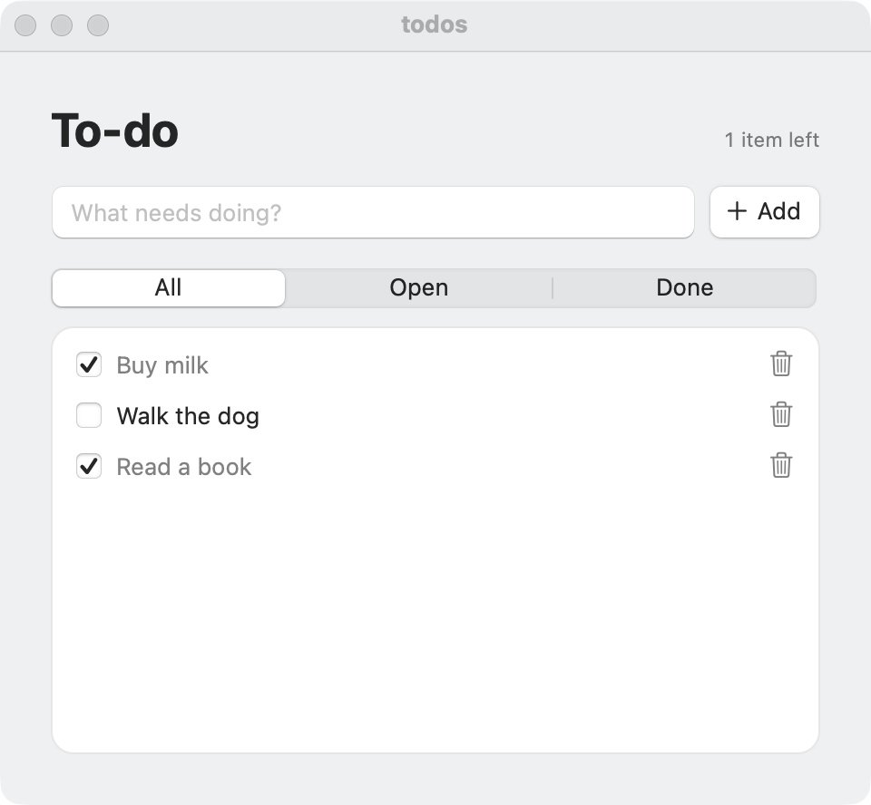

# roc-native-macos (spike)

> [!NOTE]
> This is an early proof of concept. My goal is to show how
> [roc-signals](https://github.com/lukewilliamboswell/roc-signals) might look
> for native UI. I'm not sure where this project will go: I've written it for
> a bit of fun, and to help with the development of the reactive engine in
> Roc. If you're interested in this work, let me know.

A Roc platform for native macOS apps. You write the app in Roc against the
[roc-signals](https://github.com/lukewilliamboswell/roc-signals) reactive
engine: state lives in signals and stores, and the view is a tree of `Ui`
builders. The platform draws it with real AppKit controls (no browser, no
HTML, no web view) and updates only what changed.



## Quick start

Building an app needs only a Roc compiler, a current
[nightly](https://github.com/roc-lang/nightlies/releases) or 0.1.0 RC1, on
any system: macOS, Linux or Windows. The platform package carries the prebuilt
Swift host and its linker inputs, so no Xcode, Swift, Apple SDK or Mac is
involved. The app runs on Apple silicon Macs with macOS 11 or later; Intel
Macs (`x64mac`) are not supported.

Create `main.roc`, with the `platform` URL from the
[latest release](https://github.com/lukewilliamboswell/roc-native-macos/releases/latest)
(its notes give the whole header line; the URL ends in the bundle's content
hash):

```roc
app [main] { pf: platform "https://github.com/lukewilliamboswell/roc-native-macos/releases/download/<version>/<hash>.tar.zst" }

import pf.Engine exposing [Elem, In, Root, State]
import pf.Ui

## A counter: one piece of local state and three buttons that change it.
main : Engine.Program
main = Engine.program(|| Engine.state(0, view))

view : State(In(Root, I64), I64) -> Elem(In(Root, I64))
view = |count|
	Ui.vstack(
		{},
		[
			Ui.title("Counter"),
			Ui.readout_s(count.signal().map(|n| n.to_str())),
			Ui.hstack(
				{},
				[
					Ui.button("−", count.update(|n| n - 1)),
					Ui.button("Reset", count.update(|_| 0)),
					Ui.button("+", count.update(|n| n + 1)),
				],
			),
		],
	)
```

Build it:

```sh
roc build main.roc                      # on an Apple silicon Mac
roc build main.roc --target=arm64mac    # anywhere else: Linux, Windows or an Intel Mac
```

The platform has one target, `arm64mac`. Without `--target`, `roc build`
builds for the machine it runs on, so on any other system it stops with
`roc build requires --target or a platform target for ... the detected native host`.
Either way the result is `main`, a macOS executable: run `./main` on the Mac.

The window opens sized to its content. To launch it from the Finder or with
`open`, put the binary in a minimal `.app` bundle with an `Info.plist` that
names a `CFBundleIdentifier`; `scripts/build.sh` shows one (`bundle_example`).
To build against an unreleased change, see
[the bundle](docs/contributing.adoc#the-bundle) in Contributing.

## Writing an app

**Programs and state.** `Engine.program(|| view)` is an app with no store;
local state comes from `Engine.state(initial, |s| ...)`, as in the counter.
An app with shared state declares a store of cells and builds its view from
their signals:

```roc
main : Engine.Program(_)
main = Engine.program_store({}, |_boot| store, |_boot| view())

store = Engine.store(
	Stopwatch,
	{
		running: Engine.cell(Bool.False),
		elapsed_ms: Engine.cell(0.I64),
	}.Engine.Cells,
)

cells = store.cells()
```

A store needs at least two cells: a single-field record builder builds but
fails at run time with current compilers (`roc test` reports it).

**The view.** Every builder in `Ui` is a native control: stacks, forms,
scroll areas, lists backed by `NSTableView`, labels, buttons, text fields,
checkboxes, sliders, pop-up menus, segmented controls and tabs, SF Symbols,
progress bars, keyboard shortcuts, file pickers and drop zones. Layout and
text style are props records of defaulted fields, given first:
`Ui.vstack({ spacing: 12, align: Fill }, kids)`,
`Ui.text({ font: Caption, color: Secondary }, "Saved")`. A builder whose
name ends in `_s` follows a signal: `Ui.label_s(count.signal().map(|n| n.to_str()))`.

**Events.** A control takes a handler that returns writes to state:
`Ui.button("Reset", Engine.handle(|_| [cells.elapsed_ms.set(0)]))`. A text
field's handler receives the text, a checkbox's its new state.

**Effects.** HTTP requests, timers and intervals, file reads and digests
are asks that a watch site issues when a signal changes, and whose answers
come back as writes. `Engine.watch_latest` cancels what it issued when the
signal changes again:

```roc
Engine.watch_latest(
	cells.request.signal(),
	|r| if r.active [Engine.http({ url: r.url, timeout: Ms(2000), cache: NoStore })] else [],
	Engine.react(answered),
)
```

Files reach the app as handles, never bytes: `Ui.file_button` and
`Ui.drop_zone` deliver `File`s, which `sha256`, `read_utf8`, `read_bytes`
and `File.save` act on. Local storage is `UserDefaults`: declare the keys in
`Engine.program_store({ storage_keys: ["todos"] }, ...)`, read them at boot
with `Engine.boot_storage` and write them with
`Engine.command(StorageSet(key, text))`.

Each example below is a complete app. [The `Ui` reference](docs/ui.adoc)
lists every builder with its signature, what it draws and the events it
sends. The engine itself (`Engine`: signals, stores, tables, watches) is
documented in roc-signals.

## Examples

| Example | Shows |
|---|---|
| [`counter`](examples/counter/main.roc) | Local state (`Engine.state`), buttons, a readout |
| [`todos`](examples/todos/main.roc) | A store with a table, `table_view` rows (row templates) in a `Ui.scroll`, a form with Return-to-submit, a Command-N shortcut, checkboxes, `when`, saving to local storage and reading it back at boot, and `expect` tests (`roc test examples/todos/main.roc`) |
| [`gallery`](examples/gallery/main.roc) | `tabs` over pages, a dropdown, a text area, SF Symbols, progress bars, styled text, Command-N/Command-K shortcuts |
| [`contacts`](examples/contacts/main.roc) | 10,000 generated rows in a `Ui.list` (`NSTableView`), a search field filtering through the `table_view` query, row selection |
| [`stopwatch`](examples/stopwatch/main.roc) | Store cells, an interval effect owned by `watch_latest` (Stop cancels it), and an `each` list of laps |
| [`http-fetch`](examples/http-fetch/main.roc) | `Engine.http` under `watch_latest`: Fetch, Cancel (a pure cancel), a second Fetch superseding the first, an optional 2 s timeout, and transfer progress (`with_progress`) |
| [`file-inspector`](examples/file-inspector/main.roc) | `Ui.file_button` and `Ui.drop_zone` delivering `File` handles; for an inspected file its SHA-256 (`sha256`), its first 200 bytes as text or "binary" (`slice`, `read_bytes`), its URL (`object_url`) and "Save copy…" (`File.save`); Clear releases the handles |

The examples name the platform by its path in the checkout
(`../../platform/main.roc`). To run them, build the platform first:

```sh
scripts/build.sh                    # the platform and every example
./examples/todos/todos
```

## More

- [The `Ui` reference](docs/ui.adoc), for app authors.
- [Architecture](docs/architecture.adoc): the engine, the host, the wire,
  effects and threads, files, glue and linker inputs.
- [Contributing](docs/contributing.adoc): building the platform, the bundle,
  driving apps with `ROC_SCRIPT`, the check gate and findings.
  [AGENTS.md](AGENTS.md) has the repository's rules.
- Report vulnerabilities as [SECURITY.md](SECURITY.md) describes.

## Licence

[UPL 1.0](LICENSE). The engine modules come from roc-signals (UPL 1.0, the
same copyright holder). Third-party notices are in
[THIRD_PARTY_LICENSES.md](THIRD_PARTY_LICENSES.md).
