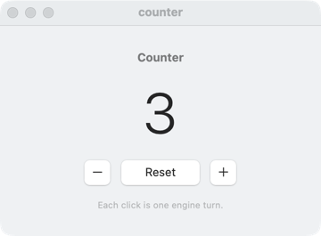
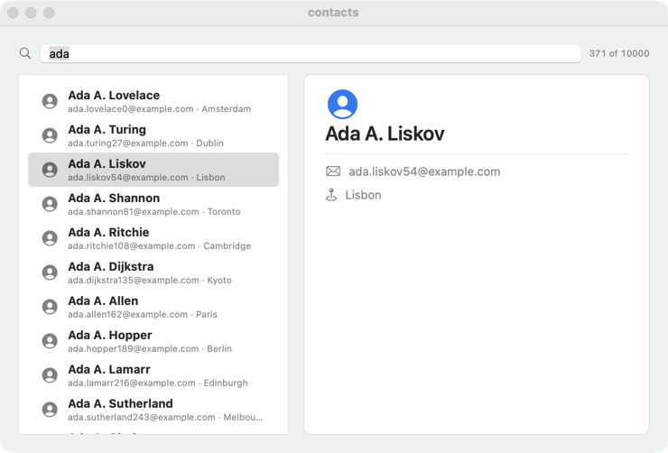
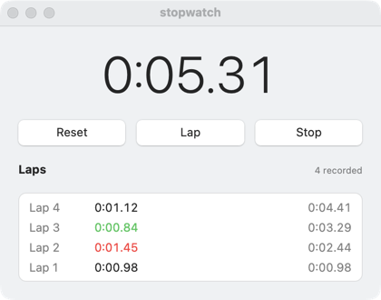
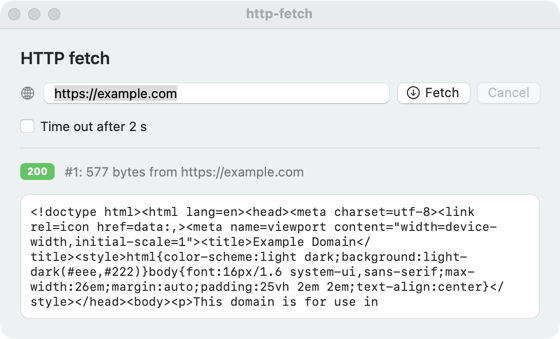

# roc-native-macos (spike)

> [!NOTE]
> This is an early proof of concept. My goal is to show how
> [roc-signals](https://github.com/lukewilliamboswell/roc-signals) might look
> for native UI. I'm not sure where this project will go: I've written it for
> a bit of fun, and to help with the development of the reactive engine in
> Roc. If you're interested in this work, let me know.

A Roc platform for native macOS apps. You write the app in Roc against the
[roc-signals](https://github.com/lukewilliamboswell/roc-signals) reactive
engine: state lives in signals and stores, and the view is a tree of `Ui`
builders. The platform draws it with real AppKit controls (no browser, no
HTML, no web view) and updates only what changed.


## Getting started

You need Roc as `roc` on your PATH: a current
[nightly](https://github.com/roc-lang/nightlies/releases) or 0.1.0 RC1. That
is all, on any system: macOS, Linux or Windows. The platform carries the
prebuilt Swift host and its linker inputs, so no Xcode, Swift or Apple SDK is
involved. The app runs on Apple silicon Macs with macOS 11 or later; Intel
Macs are not supported.

Download `macos.roc`, the tool for creating, building, running and testing an
app, and create one:

```sh
curl -LO https://github.com/lukewilliamboswell/roc-native-macos/releases/latest/download/macos.roc
roc macos.roc init counter
cd counter
roc macos.roc run
```

`init` writes a counter app, `main.roc`, whose header names the platform
release, two recorded runs of it in `tests/`, and a copy of `macos.roc`. `run`
builds `counter.app` and starts it, with its output (`dbg`, a crash report) in
the terminal. Edit `main.roc` and run it again.

| Command | What it does |
|---|---|
| `roc macos.roc init [DIR]` | create an app in `DIR`, or in this directory |
| `roc macos.roc build` | build `<name>.app`, on any system |
| `roc macos.roc run` | build the app and start it, on an Apple silicon Mac |
| `roc macos.roc test` | build the app and run its recorded cases, on an Apple silicon Mac; `--update` records what they print now |

`build` and `run` take `--id ID` (the bundle identifier, by default
`com.example.<name>`) and `--name TEXT` (the name in the menu bar), where
`<name>` is the app's directory. `roc macos.roc COMMAND --help` describes a
command.

A recorded case is `tests/<case>.script`, steps such as `click:+;dump;quit`
that drive the app's real controls without taking focus, and
`tests/<case>.expected`, what that run prints. The steps are listed in
[Driving an app](docs/contributing.adoc#driving-an-app).

`build` runs `roc build main.roc --target=arm64mac` and puts the program in a
minimal `<name>.app`. Roc's linker signs the program ad hoc wherever it is
built. A `.app` copied to a Mac from elsewhere (downloaded, or built on Linux
or Windows) may be quarantined by Gatekeeper, which then refuses to open it;
clear that with `xattr -dr com.apple.quarantine counter.app`.

An app is one `main.roc`. A smaller counter than the one `init` writes:

```roc
app [main] { pf: platform "https://github.com/lukewilliamboswell/roc-native-macos/releases/download/<version>/<hash>.tar.zst" }

import pf.Engine exposing [Elem, In, Root, State]
import pf.Ui

## A counter: one piece of local state and three buttons that change it.
main : Engine.Program
main = Engine.program(|| Engine.state(0, view))

view : State(In(Root, I64), I64) -> Elem(In(Root, I64))
view = |count|
	Ui.vstack(
		{ spacing: 16, align: Center, width: AtLeast(320) },
		[
			Ui.text("Counter", { style: Headline, color: SecondaryLabel }),
			Ui.text("${count.signal()}", { size: Fixed(64), weight: Light, design: MonospacedDigits }),
			Ui.hstack(
				{ spacing: 12 },
				[
					Ui.button("−", { on_press: count.update(|n| n - 1), icon: Symbol("minus"), title_display: Hidden }),
					Ui.button("Reset", { on_press: count.update(|_| 0) }),
					Ui.button("+", { on_press: count.update(|n| n + 1), icon: Symbol("plus"), title_display: Hidden }),
				],
			),
		],
	)
```

To build against an unreleased change, see
[the bundle](docs/contributing.adoc#the-bundle) in Contributing.

## Writing an app

**Programs and state.** `Engine.program(|| view)` is an app with no store;
local state comes from `Engine.state(initial, |s| ...)`, as in the counter.
An app with shared state declares a store of cells and builds its view from
their signals:

```roc
main : Engine.Program(_)
main = Engine.program_store({}, |_boot| store, |_boot| view())

store = Engine.store(
	Stopwatch,
	{
		running: Engine.cell(Bool.False),
		elapsed_ms: Engine.cell(0.I64),
	}.Engine.Cells,
)

cells = store.cells()
```

A store needs at least two cells: a single-field record builder builds but
fails at run time with current compilers (`roc test` reports it).

**The view.** Every builder in `Ui` is a native control: stacks, forms,
scroll areas, lists backed by `NSTableView`, labels, buttons, text fields,
checkboxes, sliders, pop-up menus, segmented controls and tabs, SF Symbols,
progress bars, keyboard shortcuts, file pickers and drop zones, and `box`
surfaces. Each takes its subject first and a props record of defaulted
fields beside it (containers take their children last); name only what
differs: `Ui.text("Saved", { style: Caption1, color: SecondaryLabel })`,
`Ui.vstack({ spacing: 12, align: Fill }, kids)`. Looks are AppKit's own:
text styles, semantic colours that follow dark mode, control sizes, bezels
and SF Symbols. State is a signal and looks are values: a literal text is a
constant and `"${count} left"` follows `count`; when a look must follow state
too, the `_s` form takes the props as a signal,
`Ui.text_s(total, over.map(|o| if (o) { color: Red } else {}))`. An app
shares a look as a plain annotated value, `theme : Theme`, not a stylesheet.

**Events.** Handlers are props fields that return writes to state:
`Ui.button("Reset", { on_press: Engine.handle(|_| [cells.elapsed_ms.set(0)]) })`.
A text field's `on_input` receives the text, a checkbox's `on_change` its
new state.

**Effects.** HTTP requests, timers and intervals, file reads and digests
are asks that a watch site issues when a signal changes, and whose answers
come back as writes. `Engine.watch_latest` cancels what it issued when the
signal changes again:

```roc
Engine.watch_latest(
	cells.request.signal(),
	|r| if r.active [Engine.http({ url: r.url, timeout: Ms(2000), cache: NoStore })] else [],
	Engine.react(answered),
)
```

Files reach the app as handles, never bytes: `Ui.file_button` and
`Ui.drop_zone` deliver `File`s, which `sha256`, `read_utf8`, `read_bytes`
and `File.save` act on. Local storage is `UserDefaults`: declare the keys in
`Engine.program_store({ storage_keys: ["todos"] }, ...)`, read them at boot
with `Engine.boot_storage` and write them with
`Engine.command(StorageSet(key, text))`.

Each example below is a complete app. [The `Ui` reference](docs/ui.adoc)
lists every builder with its signature, what it draws and the events it
sends. The engine itself (`Engine`: signals, stores, tables, watches) is
documented in roc-signals.

## Examples

| Example | Shows |
|---|---|
| [`counter`](examples/counter/main.roc)<br> | Local state (`Engine.state`), icon buttons, a large monospaced readout |
| [`todos`](examples/todos/main.roc)<br> | A store with a table, `table_view` rows (row templates) in a `Ui.scroll` inside a `box`, a form with Return-to-submit, a segmented filter, a Command-N shortcut, done rows greyed by `text_s`, an empty state, a shared `Theme`, saving to local storage and reading it back at boot, and `expect` tests |
| [`gallery`](examples/gallery/main.roc)<br> | `tabs` over labelled sections: a dropdown, a slider and progress bar, a text area, text styles, semantic and adaptive colours, SF Symbols, Command-N/Command-K shortcuts |
| [`contacts`](examples/contacts/main.roc)<br> | 10,000 generated rows in a sidebar `Ui.list` (`NSTableView`), a search field filtering through the `table_view` query, a detail pane for the selected row |
| [`stopwatch`](examples/stopwatch/main.roc)<br> | Store cells, an interval effect owned by `watch_latest` (Stop cancels it), a default button, and an `each` list of laps with splits, the fastest and slowest coloured |
| [`http-fetch`](examples/http-fetch/main.roc)<br> | `Engine.http` under `watch_latest`: Fetch, Cancel (a pure cancel), a second Fetch superseding the first, an optional 2 s timeout, transfer progress (`with_progress`), and a status badge whose colour follows the answer (`box_s`) |
| [`file-inspector`](examples/file-inspector/main.roc)<br> | `Ui.file_button` and a `Ui.drop_zone` delivering `File` handles, sizes in KB and MB; for an inspected file its SHA-256 (`sha256`), its first 200 bytes as text or "binary" (`slice`, `read_bytes`), its URL (`object_url`) and "Save Copy…" (`File.save`); Clear releases the handles |

The examples name the platform by its path in the checkout
(`../../platform/main.roc`). To try one as your own app, copy its `main.roc`
over the one `init` wrote and keep `init`'s platform line. To run them all
here, build the platform first:

```sh
scripts/build.sh                    # the platform and every example
./examples/todos/todos
```

## More

- [The `Ui` reference](docs/ui.adoc), for app authors.
- [Architecture](docs/architecture.adoc): the engine, the host, the wire,
  effects and threads, files, glue and linker inputs.
- [Contributing](docs/contributing.adoc): building the platform, the bundle,
  driving apps with `ROC_SCRIPT`, the check gate and findings.
  [AGENTS.md](AGENTS.md) has the repository's rules.
- Report vulnerabilities as [SECURITY.md](SECURITY.md) describes.

## Licence

[UPL 1.0](LICENSE). The engine modules come from roc-signals (UPL 1.0, the
same copyright holder). Third-party notices are in
[THIRD_PARTY_LICENSES.md](THIRD_PARTY_LICENSES.md).
