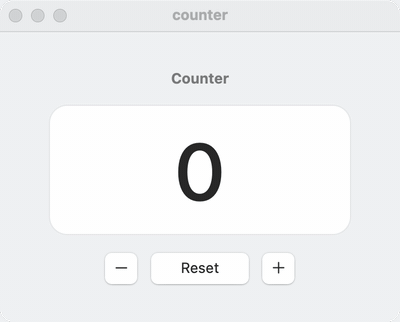
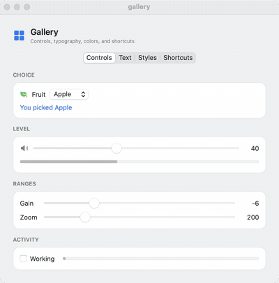
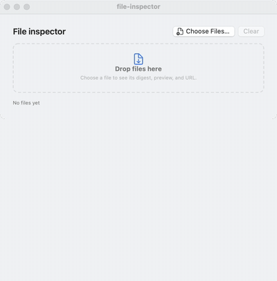
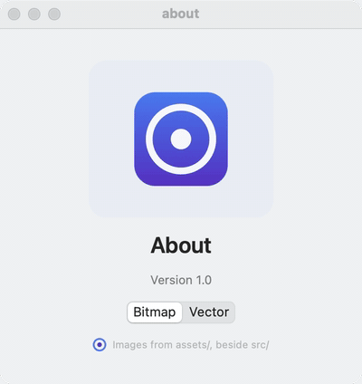

# roc-native-macos

> [!NOTE]
> This platform is new. It builds on ideas that have matured across other Roc
> platforms, and its purpose is to put those ideas to the test: a fresh take
> on UI for productivity apps, written against the
> [roc-signals](https://github.com/lukewilliamboswell/roc-signals) reactive
> engine. Consider it experimental until more people have used it and told us
> how the approach holds up. If you try it, I'd love to hear how it went.

A Roc platform for native macOS apps. You write the app in Roc against the
[roc-signals](https://github.com/lukewilliamboswell/roc-signals) reactive
engine: state lives in signals and stores, and the view is a tree of `Ui`
builders. The platform draws it with real AppKit controls (no browser, no
HTML, no web view) and updates only what changed.


## Getting started

You need Roc as `roc` on your PATH: a current
[nightly](https://github.com/roc-lang/nightlies/releases) or 0.1.0 RC1. That
is all, on any system: macOS, Linux or Windows. The platform carries the
prebuilt Swift host and its linker inputs, so no Xcode, Swift or Apple SDK is
involved. The app is universal: it runs on Apple silicon and Intel Macs with
macOS 15 or later.

Download `macos.roc`, the tool for creating, building, running and testing an
app, and create one:

```sh
curl -LO https://github.com/lukewilliamboswell/roc-native-macos/releases/latest/download/macos.roc
roc macos.roc init my-app
cd my-app
roc macos.roc run
```

`init` writes a project to build on: a small expense tracker with its app
in `src/`, its business logic as a package of pure Roc in `logic/`,
[roc-fuzz](https://github.com/lukewilliamboswell/roc-fuzz) targets for that
logic in `fuzz/`, an icon, recorded runs in `tests/`, and an `AGENTS.md`
saying how it is laid out and worked on. `run` builds `my-app.app` and
starts it. While you edit it, `roc macos.roc dev` runs the app with hot
reloading: it rebuilds as you save, and Command-R shows the new code.
`roc macos.roc build` builds the app on any system, `roc macos.roc test`
runs its `expect` tests and recorded runs, and `roc macos.roc fuzz` its fuzz
targets. `roc macos.roc package` zips the app for people to
download, signed and notarized with a Developer ID if you have one, and the
workflow `init` writes does that on GitHub when you push a tag ([Ship your app](https://lukewilliamboswell.github.io/roc-native-macos/apps.html#ship-your-app)).

An app can be as small as one `main.roc`, as this counter is:

```roc
app [main] { pf: platform "https://github.com/lukewilliamboswell/roc-native-macos/releases/download/<version>/<hash>.tar.zst" }

import pf.Engine exposing [Elem, In, Root, State]
import pf.Ui

## A counter: one piece of local state and three buttons that change it.
main : Engine.Program
main = Engine.program(|| Engine.state(0, view))

view : State(In(Root, I64), I64) -> Elem(In(Root, I64))
view = |count|
	Ui.vstack(
		{ spacing: 16, align: Center, width: AtLeast(320) },
		[
			Ui.text("Counter", { style: Headline, color: SecondaryLabel }),
			Ui.text("${count.signal()}", { size: Fixed(64), weight: Light, design: MonospacedDigits }),
			Ui.hstack(
				{ spacing: 12 },
				[
					Ui.button("−", { on_press: count.update(|n| n - 1), icon: Symbol("minus"), title_display: Hidden }),
					Ui.button("Reset", { on_press: count.update(|_| 0) }),
					Ui.button("+", { on_press: count.update(|n| n + 1), icon: Symbol("plus"), title_display: Hidden }),
				],
			),
		],
	)
```

[Build an app](https://lukewilliamboswell.github.io/roc-native-macos/apps.html) covers the tool, writing an app, testing it
with recorded runs, and shipping it. [The `Ui` reference](https://lukewilliamboswell.github.io/roc-native-macos/ui.html) lists
every builder with its signature, what it draws and the events it sends.
Both are chapters of [the manual](https://lukewilliamboswell.github.io/roc-native-macos/)
([PDF](https://lukewilliamboswell.github.io/roc-native-macos/roc-native-macos.pdf)).

## Examples

Each example is a complete app. To try one, download the examples archive
from the [latest release](https://github.com/lukewilliamboswell/roc-native-macos/releases/latest)
and run it with `macos.roc`, as [Try an example](https://lukewilliamboswell.github.io/roc-native-macos/apps.html#try-an-example)
describes.

<table>
<tr>
<td width="33%" valign="top"><a href="examples/counter/"></a><br><a href="examples/counter/"><code>counter</code></a>: local state and three buttons</td>
<td width="33%" valign="top"><a href="examples/todos/"></a><br><a href="examples/todos/"><code>todos</code></a>: a stored table, a form and a filter</td>
<td width="33%" valign="top"><a href="examples/stopwatch/"></a><br><a href="examples/stopwatch/"><code>stopwatch</code></a>: an interval effect and a list of laps</td>
</tr>
<tr>
<td width="33%" valign="top"><a href="examples/contacts/"></a><br><a href="examples/contacts/"><code>contacts</code></a>: searching 10,000 rows in a native list</td>
<td width="33%" valign="top"><a href="examples/gallery/"></a><br><a href="examples/gallery/"><code>gallery</code></a>: tabs over native controls and looks</td>
<td width="33%" valign="top"><a href="examples/http-fetch/"></a><br><a href="examples/http-fetch/"><code>http-fetch</code></a>: HTTP requests, their errors and answers</td>
</tr>
<tr>
<td width="33%" valign="top"><a href="examples/file-inspector/"></a><br><a href="examples/file-inspector/"><code>file-inspector</code></a>: dropped files: sizes, digests, previews</td>
<td width="33%" valign="top"><a href="examples/about/"></a><br><a href="examples/about/"><code>about</code></a>: images from the app's assets, and its icon</td>
<td width="33%" valign="top"><a href="examples/workers/"></a><br><a href="examples/workers/"><code>workers</code></a>: Roc jobs on background threads, with Cancel</td>
</tr>
</table>

[What each example shows](https://lukewilliamboswell.github.io/roc-native-macos/apps.html#the-examples) lists the API each one
uses.

## Contributing

To change the platform itself, see [CONTRIBUTING.md](CONTRIBUTING.md). Report
vulnerabilities as [SECURITY.md](SECURITY.md) describes.

## Licence

[UPL 1.0](LICENSE). The engine modules come from roc-signals (UPL 1.0, the
same copyright holder). Third-party notices are in
[THIRD_PARTY_LICENSES.md](THIRD_PARTY_LICENSES.md).
