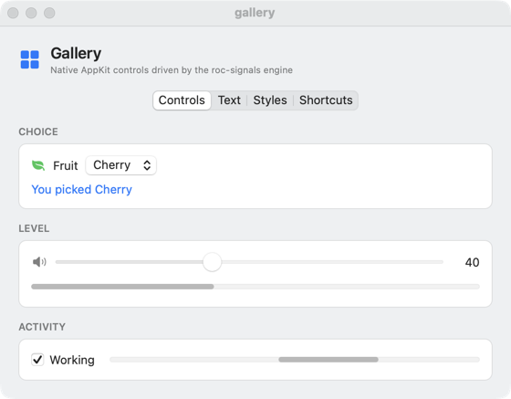
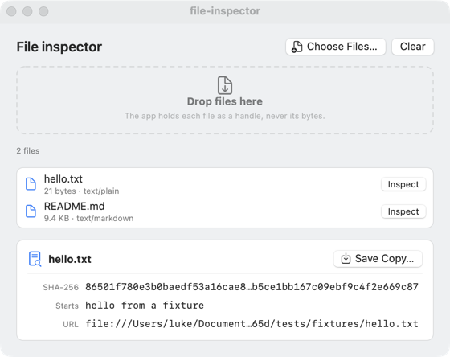

# roc-native-macos (spike)

> [!NOTE]
> This is an early proof of concept. My goal is to show how
> [roc-signals](https://github.com/lukewilliamboswell/roc-signals) might look
> for native UI. I'm not sure where this project will go: I've written it for
> a bit of fun, and to help with the development of the reactive engine in
> Roc. If you're interested in this work, let me know.

A Roc platform for native macOS apps. You write the app in Roc against the
[roc-signals](https://github.com/lukewilliamboswell/roc-signals) reactive
engine: state lives in signals and stores, and the view is a tree of `Ui`
builders. The platform draws it with real AppKit controls (no browser, no
HTML, no web view) and updates only what changed.


## Getting started

You need Roc as `roc` on your PATH: a current
[nightly](https://github.com/roc-lang/nightlies/releases) or 0.1.0 RC1. That
is all, on any system: macOS, Linux or Windows. The platform carries the
prebuilt Swift host and its linker inputs, so no Xcode, Swift or Apple SDK is
involved. The app runs on Apple silicon Macs with macOS 11 or later; Intel
Macs are not supported.

Download `macos.roc`, the tool for creating, building, running and testing an
app, and create one:

```sh
curl -LO https://github.com/lukewilliamboswell/roc-native-macos/releases/latest/download/macos.roc
roc macos.roc init counter
cd counter
roc macos.roc run
```

`init` writes a counter app, `main.roc`, whose header names the platform
release, and two recorded runs of it in `tests/`. `run` builds `counter.app`
and starts it. Edit `main.roc` and run it again; `roc macos.roc build` builds
the app on any system, and `roc macos.roc test` runs its recorded cases.

An app is one `main.roc`. A smaller counter than the one `init` writes:

```roc
app [main] { pf: platform "https://github.com/lukewilliamboswell/roc-native-macos/releases/download/<version>/<hash>.tar.zst" }

import pf.Engine exposing [Elem, In, Root, State]
import pf.Ui

## A counter: one piece of local state and three buttons that change it.
main : Engine.Program
main = Engine.program(|| Engine.state(0, view))

view : State(In(Root, I64), I64) -> Elem(In(Root, I64))
view = |count|
	Ui.vstack(
		{ spacing: 16, align: Center, width: AtLeast(320) },
		[
			Ui.text("Counter", { style: Headline, color: SecondaryLabel }),
			Ui.text("${count.signal()}", { size: Fixed(64), weight: Light, design: MonospacedDigits }),
			Ui.hstack(
				{ spacing: 12 },
				[
					Ui.button("−", { on_press: count.update(|n| n - 1), icon: Symbol("minus"), title_display: Hidden }),
					Ui.button("Reset", { on_press: count.update(|_| 0) }),
					Ui.button("+", { on_press: count.update(|n| n + 1), icon: Symbol("plus"), title_display: Hidden }),
				],
			),
		],
	)
```

[Build an app](docs/apps.adoc) covers the tool, writing an app, testing it
with recorded runs, and sharing it. [The `Ui` reference](docs/ui.adoc) lists
every builder with its signature, what it draws and the events it sends.

## Examples

Each example is a complete app. To try one, download the examples archive
from the [latest release](https://github.com/lukewilliamboswell/roc-native-macos/releases/latest)
and run it with `macos.roc`, as [Try an example](docs/apps.adoc#try-an-example)
describes.

| Example | Shows |
|---|---|
| [`counter`](examples/counter/main.roc)<br> | Local state (`Engine.state`), icon buttons, a large monospaced readout |
| [`todos`](examples/todos/main.roc)<br> | A store with a table, `table_view` rows (row templates) in a `Ui.scroll` inside a `box`, a form with Return-to-submit, a segmented filter, a Command-N shortcut, done rows greyed by `text_s`, an empty state, a shared `Theme`, saving to local storage and reading it back at boot, and `expect` tests |
| [`gallery`](examples/gallery/main.roc)<br> | `tabs` over labelled sections: a dropdown, a slider and progress bar, a text area, text styles, semantic and adaptive colours, SF Symbols, Command-N/Command-K shortcuts |
| [`contacts`](examples/contacts/main.roc)<br> | 10,000 generated rows in a sidebar `Ui.list` (`NSTableView`), a search field filtering through the `table_view` query, a detail pane for the selected row |
| [`stopwatch`](examples/stopwatch/main.roc)<br> | Store cells, an interval effect owned by `watch_latest` (Stop cancels it), a default button, and an `each` list of laps with splits, the fastest and slowest coloured |
| [`http-fetch`](examples/http-fetch/main.roc)<br> | `Engine.http` under `watch_latest`: Fetch, Cancel (a pure cancel), a second Fetch superseding the first, an optional 2 s timeout, transfer progress (`with_progress`), and a status badge whose colour follows the answer (`box_s`) |
| [`file-inspector`](examples/file-inspector/main.roc)<br> | `Ui.file_button` and a `Ui.drop_zone` delivering `File` handles, sizes in KB and MB; for an inspected file its SHA-256 (`sha256`), its first 200 bytes as text or "binary" (`slice`, `read_bytes`), its URL (`object_url`) and "Save Copy…" (`File.save`); Clear releases the handles |

## Contributing

To change the platform itself, see [CONTRIBUTING.md](CONTRIBUTING.md). Report
vulnerabilities as [SECURITY.md](SECURITY.md) describes.

## Licence

[UPL 1.0](LICENSE). The engine modules come from roc-signals (UPL 1.0, the
same copyright holder). Third-party notices are in
[THIRD_PARTY_LICENSES.md](THIRD_PARTY_LICENSES.md).
