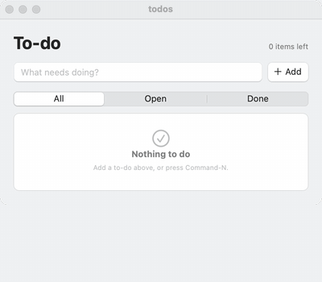
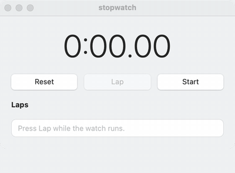
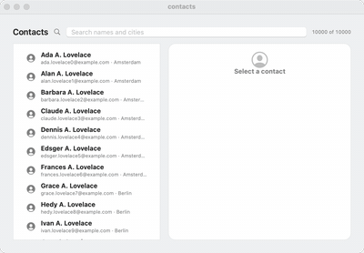
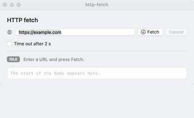
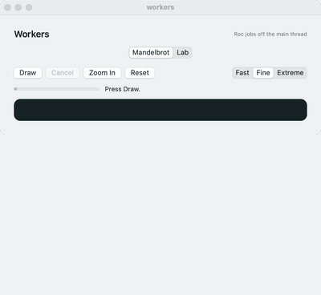

# roc-native-macos

Build native macOS apps in Roc. Write a view with `Ui` builders and use
signals and stores to manage state. The platform renders native AppKit
controls and uses the roc-signals engine to update the parts that read
changed state. [roc-signals](https://github.com/lukewilliamboswell/roc-signals)

> [!NOTE]
> This is a new platform. Expect features to be missing
> as we test it with more apps and welcome any new
> contributors. If you try it, please let me know. Good and bad experiences help me to understand where to focus.


## Getting started

To run your first app, use an Apple silicon or Intel Mac with macOS 15 or
later. Put `roc` on your PATH using the compiler named in the release notes
or a compatible nightly.
Our releases include a pre-compiled Swift host library and linker inputs. You can also cross-compile apps from Linux or Windows.
[Roc nightlies](https://github.com/roc-lang/nightlies/releases)

Run the `roc run … init my-app` command from the release notes. Roc fetches
the installer and writes `macos.roc` into the new project. If the release
notes omit that command, download `macos.roc` from the release page and run
`roc macos.roc init my-app` from the download directory.
[Latest release](https://github.com/lukewilliamboswell/roc-native-macos/releases/latest)

Start the app in development mode.

```sh
cd my-app
roc macos.roc dev
```

The starter app is a music player with a visualizer and timed lyrics. Press Play
to hear the bundled song, and use Command-L to show the lyrics. Its source
comments point you to the modules you can change and the relevant sections
of the manual. Roc rebuilds when you save. Press Command-R in the app
to load the changes. [Automatic reload progress](https://github.com/roc-lang/roc/pull/12642)

With the runnable installer, add `--simple` after `init` to create a
counter with one source module and its specs.
[Counter source](examples/counter/src/main.roc)

[Build an app](https://lukewilliamboswell.github.io/roc-native-macos/apps.html)
covers project layout, testing and shipping.
[The `Ui` reference](https://lukewilliamboswell.github.io/roc-native-macos/ui.html#builders)
lists the builders, properties and events. Both chapters are part of the
[manual](https://lukewilliamboswell.github.io/roc-native-macos/), also available
[as a PDF](https://lukewilliamboswell.github.io/roc-native-macos/roc-native-macos.pdf).

## Examples

Download and unzip the examples archive. On a Mac, open an example's
directory and use the tool from the same release.
[Latest release](https://github.com/lukewilliamboswell/roc-native-macos/releases/latest) ·
[Try an example](https://lukewilliamboswell.github.io/roc-native-macos/apps.html#try-an-example)

<table>
<tr>
<td width="33%" valign="top"><a href="examples/counter/"></a><br><a href="examples/counter/"><code>counter</code></a>: local state and three buttons</td>
<td width="33%" valign="top"><a href="examples/todos/"></a><br><a href="examples/todos/"><code>todos</code></a>: a stored table, a form and a filter</td>
<td width="33%" valign="top"><a href="examples/stopwatch/"></a><br><a href="examples/stopwatch/"><code>stopwatch</code></a>: an interval effect and a list of laps</td>
</tr>
<tr>
<td width="33%" valign="top"><a href="examples/contacts/"></a><br><a href="examples/contacts/"><code>contacts</code></a>: searching 10,000 rows in a native list</td>
<td width="33%" valign="top"><a href="examples/gallery/"></a><br><a href="examples/gallery/"><code>gallery</code></a>: tabs over native controls and looks</td>
<td width="33%" valign="top"><a href="examples/http-fetch/"></a><br><a href="examples/http-fetch/"><code>http-fetch</code></a>: HTTP requests, their errors and answers</td>
</tr>
<tr>
<td width="33%" valign="top"><a href="examples/file-inspector/"></a><br><a href="examples/file-inspector/"><code>file-inspector</code></a>: dropped files: sizes, digests, previews</td>
<td width="33%" valign="top"><a href="examples/about/"></a><br><a href="examples/about/"><code>about</code></a>: images from the app's assets, and its icon</td>
<td width="33%" valign="top"><a href="examples/workers/"></a><br><a href="examples/workers/"><code>workers</code></a>: Roc jobs on background threads, with Cancel</td>
</tr>
</table>

The [starter](examples/starter/) combines app layout, audio and lyrics.
The [player](examples/player/) focuses on audio playback, the equalizer and
measurements. The [visualizer](examples/visualizer/) focuses on drawing
surfaces and Metal shaders.
[Example guide](https://lukewilliamboswell.github.io/roc-native-macos/apps.html#the-examples)

## Contributing

To change the platform itself, see [CONTRIBUTING.md](CONTRIBUTING.md). Report
vulnerabilities as [SECURITY.md](SECURITY.md) describes.

## Licence

[UPL 1.0](LICENSE). The engine modules come from roc-signals (UPL 1.0, the
same copyright holder). Third-party notices are in
[THIRD_PARTY_LICENSES.md](THIRD_PARTY_LICENSES.md).
